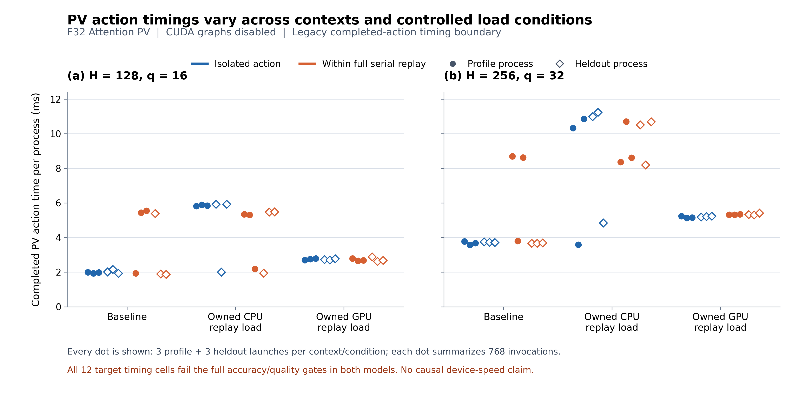

# Device-State Calibration and Accuracy Validation

**Historical diagnostic protocol.** Its constant and named-condition tables
compare measurement regimes; they are not separate intended simulator models.
The primary interface is now [one resource-trace functional](UNIFIED_RESOURCE_FUNCTIONAL.md).
All results and failed gates below remain unchanged.

**Status: engineering implemented and software tested; formal experimental
evidence independently verified; performance accuracy FAILED under the unchanged
gates.** The earlier accuracy failures have not been reclassified as device noise
or removed.

## Question and deliverables

The task is to record device state alongside operator latency, investigate the
large performance errors, connect measured state-dependent costs to the
simulator, and test the resulting system. Identical matrix geometry does not
imply identical latency across execution contexts and device conditions.
However, observing a different GPU clock or utilization counter does not, by
itself, establish why a process was slower.

The implementation now provides three linked components:

1. A reusable native experiment and bounded telemetry collector, with exact
   source, binary, runtime, command, numerical and timing evidence.
2. Profile-only constant and named-condition cost tables, evaluated against
   separate fresh-process heldout runs under unchanged gates.
3. Exact CPU/GPU service-rate changes in the common runtime, plus a restricted
   adapter connecting one measured GPU target to that runtime.

## What is measured

The native probe executes a real F32 Dense graph exported through the public
Python strategy/compiler path. Its selected GPU target is the
`attention_pv` graph action. The target can be measured alone or within the
complete mixed CPU/GPU action replay. Target-action and whole-iteration latency
are separate metrics; the latter cannot become a GPU operator price.
CUDA graphs are explicitly disabled and all primary actions use the historical
completed-work synchronization boundary. These prices are not estimates of a
CUDA-graph-enabled production decode loop or pure device execution.

Device observations use the native monotonic clock, with query begin/end times.
Direct NVML queries record supported GPU utilization, clocks, power, temperature,
performance state and memory occupancy. Windows CPU busy time is an OS counter
interval, not a per-process instruction count. Unsupported observations remain
unknown. No device clocks, power limits or user applications are modified.

The collector does not interpolate sampled state into short actions. A query
must lie wholly inside a timed interval to enter its numerical summary; CPU
counter intervals must also be contained. NVML utilization remains a rolling
driver observation. Sustained-block summaries establish descriptive association,
not instantaneous kernel occupancy or causality.

The source-bound runner can introduce an owned, finite CPU or GPU replay process.
It checks the background process and its active timing envelope, rather than
treating a ready signal as evidence of continuous contention. These named
conditions are controlled experiment labels, not an automatic state classifier
and not prescribed CPU/GPU utilization percentages.

## Runtime and cost model

Each running CPU/GPU operation retains an exact rational amount of reference
work. Explicit device-rate events change its progress while it runs. Rate one
half consumes half a reference nanosecond per wall nanosecond; zero pauses it.
CPU availability blackouts compose with these rates. Inputs, output reservations
and workspace stay committed until completion. Fractional work is retained
across other events, and only final wall-clock completion is rounded upward.

Current effective rates are visible to policies; future event times and states
are private. Reference prices remain unchanged, while
`DevicePrice.current_duration_ns` separately exposes the estimate at the current
rate. Existing ranking rules continue to use reference prices unless they
explicitly adopt that estimate. Checkpoint replay binds exact fractional work.

The measured tables use exact case, execution mode, instrumentation, telemetry
setting, metric and externally verified named condition. The constant model
pools conditions within one exact context; the conditional model keeps them
separate. There is no shape interpolation, unknown-condition fallback, outlier
removal or heldout fitting.

The measured-target adapter verifies the frozen model, profile rows, native
target and source program hashes. It creates a sealed **one-task timing
carrier**, using the integer reference price divided by the exact conditional
median as its rational rate. It cannot apply one target's slowdown to an
arbitrary LLM pipeline. Source-gate failures require explicit diagnostic opt-in;
numerically invalid or unknown prices remain unavailable.

The carrier's 4 B input, 4 B output, 8 B capacity and zero workspace are explicit
synthetic fixture values. They are not the physical PV graph's memory model.
Private CUDA scratch remains unknown, and no physical capacity accuracy is
claimed. A device-wide service multiplier is an execution mechanism, not a
universal calibrated hardware law. Fixed host launch/synchronization overhead
also need not scale with GPU throughput. See
[runtime semantics and usage](DEVICE_STATE_RUNTIME.md).

## A confirmed numerical defect in the new probe

A paired startup diagnostic used the same program and native binary. With
`NVIDIA_TF32_OVERRIDE` absent in the parent environment, the new probe failed the
independent numerical oracle despite exiting successfully. Setting the override
to zero **before process launch** passed, with maximum absolute error
**1.6093254089355469e-6**, under unchanged absolute and relative tolerances
of `5e-5`.

The runner now establishes both the TF32 override and CUDA-graph setting before
launching the child and verifies the requested precision flags. Setting an
environment variable inside `main` is not sufficient evidence that dependency
initialization observed it.

This is a numerical correctness defect in the new entry point. The diagnostic
does **not** identify the cause of the earlier high-level latency errors, prove
which kernel executed, or establish a performance improvement. The paired raw
evidence is retained in
`profiling/state_calibration/results/precision-launch-ab-v1/`.

## Pilot-v4 observations: useful diagnosis, no accepted calibration

The six pilot profile runs used one process per cell, one H256/q32/history-0
geometry, and both isolated and mixed execution. All six passed the numerical
checks. The target medians and raw within-process variation were:

| Execution | Named condition | Target median (ms) | Within-process CV | Block alignment ready |
|---|---|---:|---:|---|
| Isolated | Baseline | 3.825 | 48.6% | Yes |
| Mixed | Baseline | 8.600 | 38.9% | No |
| Isolated | CPU replay load | 10.723 | 11.7% | Yes |
| Mixed | CPU replay load | 10.647 | 13.1% | No |
| Isolated | GPU replay load | 4.989 | 34.4% | No |
| Mixed | GPU replay load | 5.633 | 104.2% | No |

All six cells fail the minimum three-process requirement. Four also fail the
within-process CV gate, and four fail telemetry-alignment readiness. Consequently
**none is an accepted calibrated price**. The raw records and failed gates are
retained in `profiling/state_calibration/results/smoke-v4/`.

The baseline isolated and mixed runs both reported median SM clock 1605 MHz,
yet their target medians differed by about 2.25 times. This does not isolate a
cause: the preceding execution context and host synchronization path differ.
The GPU-replay condition also changed clocks and power. A single utilization or
clock counter therefore cannot be used as an established latency formula.
These observations motivate the controlled formal comparisons; they do not
rescue unstable samples or prove that external contention explains every error.

A later 14-job diagnostic pilot (`smoke-v5/`, described in
`smoke-v5-description/REPORT.md`) completed numerical checks with a 50 ms
high-resolution sampling timer. One isolated target pair measured 3.8081 ms at
the legacy boundary and 3.7346 ms with one synchronization. This preliminary
comparison does not show a large decrease from removing the extra wait. Separate
process variation and altered instrumentation remain confounders. CUDA stream
event intervals include submission gaps and exclude waiting before the start
event; they are not pure kernel-active time and cannot be added to host columns
as independent costs.

## Diagnostic boundaries and source inspection

The v5 diagnostic pilot passed independent numerical checks in all 14 observer
and execution-boundary controls. At one isolated H256/q32 point, legacy
double synchronization measured 3.808 ms, asynchronous submission plus one
synchronization 3.735 ms, and the event-instrumented boundary 3.705 ms. These
single-process comparisons do not establish a calibrated speedup or identify
duplicate synchronization as the dominant error source.

Within the asynchronous event-free invocation, median host submission was
3.707 ms and the final synchronization was 0.0037 ms. Submission includes the
backend's host graph traversal, CUDA/cuBLAS calls, possible internal blocking
and caller descheduling. It overlaps device progress. The event-instrumented
stream span was 3.669 ms; it includes command-submission gaps and is not pure
kernel-active time. These columns must not be added or subtracted as independent
cost components.

Source inspection provides two concrete modeling boundaries. First, the selected
`attention_pv` action includes layout/materialization operations and KV packing,
so a bare GEMM price is not an equivalent cost. Second, the persistent GGML CPU
threadpool can poll after preceding CPU work (the pinned default polling budget
is 6,553,600 rounds), providing a possible mixed-context interaction. No
controlled polling intervention was performed, so this is a hypothesis rather
than a demonstrated cause of the observed millisecond latency.

## Frozen acceptance rules

| Requirement | Fixed rule |
|---|---|
| Numerical correctness | Independent full-port comparison, `atol=rtol=5e-5`, plus native copy/repeat checks |
| Profile and heldout within-process CV | At most 0.15 |
| Between-process median CV | At most 0.20 |
| Heldout pooled-median relative error | At most 0.20 |
| Fresh processes | At least three records per split and exact context |
| Sampling | Equal positive sample counts; no resampling or filtering |
| Separation | All profiles finish and the model freezes before heldout starts; disjoint split seeds |
| Telemetry alignment | Required blocks pass the existing observation quality checks |

Alignment checks require at least three contained observations and an interval
spanning at least three sampling periods. Excessive gaps, uncovered edges,
observer duration or absent fields remain explicit failures. Tolerances and
acceptance gates are not relaxed to make the pilot pass.

## Formal campaign protocol

The completed full campaign contains **114 main native launches and 48 owned
background launches**:

- **72 primary launches:** two geometries (H128/q16 and H256/q32), two execution
  modes, three conditions, two splits and three fresh-process repeats per split.
- **24 observation controls:** stamped/bare execution crossed with telemetry
  on/off, both modes and three repeats; excluded from fitting.
- **18 execution-boundary controls:** `legacy_double_sync`, `async_one_sync`
  and `async_events`, both modes and three repeats; excluded from fitting.
- The 48 primary load-condition jobs each launch one owned background process;
  baseline and diagnostic jobs do not add a contender.

Each primary process uses 20 warmups and three blocks of 256 individual
invocations. The minimum block duration is 200 ms; the current formal sampling
interval is 50 ms. The model retains individual invocation samples, not just
block averages. The manifest is the authority for the final executed settings.

Only `legacy_double_sync` primary observations enter the current fitted tables.
The asynchronous variants separate host wait spans from GPU event timing for
diagnosis; they cannot be substituted into that price context. The target
adapter requires explicit matching boundary evidence. Native numerical checks
and independent source/heldout verification remain separate from accuracy gates.

Source files, original runtime assets and old rejected experiments are preserved.
Large raw outputs remain locally under ignored
`profiling/state_calibration/results/`; source and compact public reports can be
distributed independently. Original pre-change sources are archived under
`profiling/state_calibration/archive-pre-state-v1/`.

## Verified formal profile and heldout results

`profiling/state_calibration/results/formal-v1/report.json` now contains the
frozen-profile evaluation of all 36 profile and 36 heldout primary processes.
All 114 main processes, including the 42 diagnostic controls, passed their
recorded numerical checks. The independent verifier reconstructed **114/114**
records, checked **4799 unchanged input bindings**, and confirmed the frozen
profile/heldout separation. Verification launched no native process. The
[portable verification receipt](data/device-state-validation-20261018.json)
validates the evidence; it does not override failed accuracy gates.

Among the 72 primary processes, **67/72** pass block-alignment readiness, while
only **36/72** pass the target within-process CV gate; the whole-iteration count
is also **36/72**. All 102 telemetry-enabled main processes recorded use of the
private high-resolution timer at the declared 50 ms cadence. A valid timer
implementation does not guarantee that every observed sampling gap meets the
quality gate. All 55,296 primary samples per timing metric are retained.

Each family evaluates **24 cells**: two geometries, two execution contexts and
three conditions give 12 exact context/condition combinations, each evaluated
for target-action latency and whole-iteration latency. The model uses profile
measurements only. No heldout values were fitted or used to change gates.

| Model | Metric | Cells | Median relative error | Worst relative error | Fully accepted |
|---|---|---:|---:|---:|---:|
| Constant | Target action | 12 | 41.8193% | 112.6683% | 0 |
| Conditional | Target action | 12 | 1.8210% | 159.0839% | 0 |
| Constant | Whole iteration | 12 | 24.1193% | 234.4719% | 0 |
| Conditional | Whole iteration | 12 | 1.8307% | 116.1651% | 0 |

Across both metrics, the constant model has median error **33.3344%** and worst
error **234.4719%**. The conditional model has median error **1.8210%** and worst
error **159.0839%**. The error-only 20% criterion is met in 9/24 constant and
17/24 conditional cells, but **both models have 0/24 fully accepted cells**.
Source/heldout variation and alignment failures are retained. A low pooled
median error does not make unstable prices or incomplete state alignment valid.

Conditioning helps the middle of this measured error distribution, while the
target-action worst case becomes worse. In particular, baseline mixed execution
still has large heldout errors. The named background condition is therefore not
a sufficient description of every performance-relevant state. Additional effects
in host submission, preceding execution context and CPU scheduling are candidates
for investigation; frequency alone is not an established explanation. These are
unproven hypotheses, not a causal attribution or an accepted universal slowdown
model.

## Background activity and execution-boundary diagnosis

The separate [background-activity report](data/device-state-background-20261018.json)
reconstructed 48 observed load jobs, 66 jobs for which an owned contender was not
applicable, and zero unknown activity scopes. Recorded background invocation
brackets cover **51.12–99.84%** of complete main-block time and **61.86–100%** of
selected PV-action time across the relevant jobs. These are host-bracket
intersections, not CPU/GPU active occupancy. A bracket includes submission,
possible descheduling, driver calls and synchronization. The main workload can
itself lengthen a background bracket, so coverage is not an independent physical
load measurement. Baseline means no owned replay, not an otherwise idle machine.

One informative outlier is H128/q16 isolated execution with CPU replay. Profile
target medians were approximately 5.82, 5.89 and 5.85 ms. Heldout repeat 1 instead
measured **2.00975 ms**, while the other heldout repeats were about 5.93 ms. Median
SM clock was 1605 MHz in these runs. The p99 uncovered gap **inside the main-block
windows** was **35.7022 ms** in that heldout repeat, versus **0.7175–1.0239 ms**
in the three profile runs. This statistic is distinct from the background's
global inter-invocation gap distribution. It suggests that a shared named load
label can hide different overlap patterns, without proving what caused the
foreground latency. No heldout-derived correction was fitted.

Windows affinity was explicit: the main process and CPU contender used
logical-CPU mask **3**; the GPU contender's host process used mask **12**.
Machine-wide CPU busy percentage can therefore be low while those selected
logical CPUs contend. Both background types retain a full initialized executor,
including CUDA allocations; neither is an abstract utilization knob.

The 18 formal boundary controls produced these descriptive ranges across three
fresh processes per entry:

| Context | Selected-target boundary | Target median range (ms) | Median SM-clock range (MHz) |
|---|---|---:|---:|
| Isolated | Legacy double synchronization | 3.628–3.799 | 1605 |
| Isolated | Asynchronous submission, one synchronization | 3.694–3.864 | 1605 |
| Isolated | Asynchronous submission with CUDA events | 3.764–3.881 | 1605 |
| Mixed | Legacy double synchronization | 3.682–3.938 | 1605 |
| Mixed | Asynchronous submission, one synchronization | 8.465–8.993 | 435–495 |
| Mixed | Asynchronous submission with CUDA events | 8.296–8.812 | 420–1605 |

Source inspection found the same graph and inputs, without a skipped hidden
pre-synchronization, thread-pool step, input reset or rebuild. However, the
asynchronous variants add six QPC sub-timestamps and `TargetTiming` JSON
construction. The latter occurs after the outer target-action timestamp but
inside the complete iteration and can affect subsequent execution context.
These are therefore **not pure extra-synchronization comparisons**. The mixed
latency and clock differences are associations, not proof that removing a wait
causes a slowdown. CUDA event spans include command-submission gaps, and host
and stream measurements are not additive kernel components.

Observation controls also vary across fresh processes; their ratios cannot be
subtracted as known sampler or timestamp overhead. The complete tables are in
the [public evidence summary](data/device-state-calibration-20261018.json);
the local narrative is retained at
`profiling/state_calibration/results/formal-v1-description/REPORT.md`.
A useful next controlled experiment would match the legacy instrumentation,
hold two worker threads fixed, compare polling settings 50 and 0, and collect
per-thread CPU time alongside QPC intervals. That experiment was **not run** in
this campaign; host work, waiting and scheduling remain hypotheses to separate.

## Measured-target runtime reconstruction

Formal saved data passed **20/20** adapter checks: 12 constant-condition timings
and eight mid-task condition-change timelines. Four additional checks
confirmed that default use rejects unaccepted source profiles. The explicit
diagnostic path retained all source failures and produced the expected exact
reference-work progression. The [portable adapter receipt](data/device-state-validation-20261018.json)
records no native launches, physical capacity proof, whole-LLM timing proof or
heldout accuracy claim. Passing these checks establishes correct cost-to-runtime
wiring; it does not make an unstable measured price accurate.

A [public evidence summary](data/device-state-calibration-20261018.json) contains
the retained numerical results, per-cell failures, controls and source hashes.

Each point is one process median, with all 72 primary processes shown. The
figure does not remove rejected cells or average them into apparent acceptance.
The [SVG](figures/device-state-calibration-20261018.svg) and
[plotting script](../profiling/state_calibration/plot_results.py) are available.

## Final regression and verification status

The final nonoverlapping inventory contains **2338 tests: 2330 passed and eight
were explicitly skipped**. Modeling ran 355, Mapping 1119, public-library and
distribution checks 56, profiling contracts 475, execution/batch/composition
calibration 54/15/26, common/chain/overlap/workload accuracy 54/13/13/14, native
batch guards eight, the extended state suite 130, and native state guards six.
Five skips require the optional GGUF dependency, two require absent Nsight
artifacts, and one is an opt-in untimed native check. The no-profile wheel/sdist
installation test ran successfully and was rerun after adding the new runtime
usage guide to the source distribution. This rerun does not increase the unique
test count.

The initial complete run retained one test-fixture error: its malformed profile
was rejected by the new model guard before the adapter assertion was reached.
Only that test's expectation was corrected; production guards were unchanged.
The entire affected state suite was then rerun, including six newly added
thread-context tests: **130/130 passed**. Unaffected passing groups were not
rerun. Original logs remain in `build/state-comprehensive-v1/`; the final state
log is `build/state-final-extended-tests.log`. Software correctness does not
establish calibrated prediction accuracy. Per-group counts and log hashes are
included in the [portable validation receipt](data/device-state-validation-20261018.json).

| Final evidence | Status |
|---|---|
| Formal campaign directory and completed launch counts | `formal-v1`: 114/114 main plus 48 owned background processes completed |
| Independent raw-evidence verifier receipt | Passed: 114/114 records, 4799 bindings unchanged; zero native launches |
| Conditional/constant target and iteration heldout errors | Verified values above; no heldout fitting |
| Accepted cells, source/heldout CV and alignment failures | 0/24 accepted for both families; fixed failures retained |
| Observer and execution-boundary control results | 24 observer and 18 boundary controls retained; descriptive interpretation above |
| Background-activity reconstruction | 48 observed, 66 not applicable, 0 unknown; no occupancy or causal claim |
| Measured-target adapter reconstruction on formal data | 20/20 arithmetic checks; four default source-gate rejections verified |
| Comprehensive software counts, skips and log hashes | 2330 passed, 8 optional skips; final affected state suite 130/130 |

## Additional CPU-thread-context intervention

After the software tests finished, a separate diagnostic launched **12 new
processes**: three repetitions of one/two requested CPU threads and isolated/mixed
execution. Within a pair the workload graph, actions, tensors, numerical seed and
independent reference are unchanged; only the CPU thread request and dependent
identity hashes differ. All processes use the same Windows affinity mask 3,
legacy boundary, 20 warmup invocations and three blocks of at least 200 ms.
Unlike the formal campaign, this diagnostic uses a minimum-wall-time policy and
variable invocation counts. Every sample is retained; it is not a new cost fit,
heldout accuracy experiment or accepted-price export.

| Context | CPU threads requested | Three process target medians (ms) |
|---|---:|---|
| Isolated | 1 | 1.9962, 1.9521, 1.9289 |
| Isolated | 2 | 4.8071, 1.9224, 1.9384 |
| Mixed | 1 | 2.2262, 4.6866, 4.6527 |
| Mixed | 2 | 5.4746, 5.5617, 1.9240 |

All 12 pass independent numerical and protocol checks. The mixed-context
one/two-thread ordering reverses in one repetition, and repeated two-thread
isolated processes also vary markedly. This small intervention does not support
static thread count as a sufficient explanation or a universal thread penalty.
It also does not isolate threadpool polling, host scheduling or GPU clocks as
the unique cause. Thread configuration is requested through the pinned backend
API; operating-system worker count is not independently read back.

The reusable [thread-context tool](../profiling/state_calibration/thread_context.py)
and [portable diagnostic](data/thread-context-diagnostic-20261018.json) retain
this negative result. Local raw evidence is in
`profiling/state_calibration/results/thread-context-v1/`. These 12 launches are
additional to the formal 114 main and 48 background processes, and do not alter
their frozen models or acceptance.

Remaining uncertainty includes execution-context effects, synchronization and
host overhead, state variability not captured by the named conditions, and
whether the frozen conditional prices generalize to fresh processes. Real
multi-operator state-dependent LLM accuracy, quantized kernels and other hardware
remain outside the acceptance claim of this campaign.
