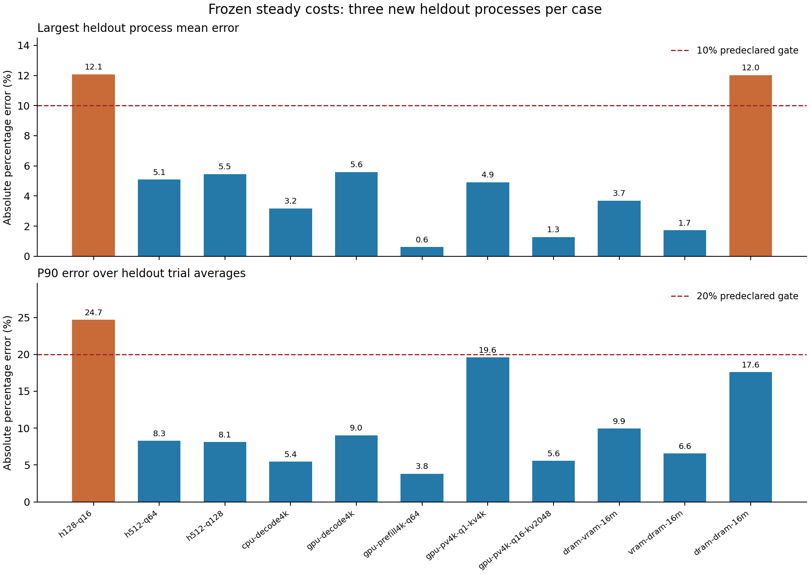

# Steady action-cost calibration and causal resource inputs

Date: 2026-10-22. This report covers a new, finite experiment; prior failed experiments remain intact.

## Outcome

The collection, frozen-parameter composition and independent validation are complete. **9/11 cases pass the mean-error and trial-P90 gates; 7/11 pass every gate**, including repeatability and applicable observer controls. Complete hybrid layers pass accuracy in 2/3 cases and every gate in 1/3. These are scoped results, not a claim of general LLM or dynamic-resource accuracy.

All 93 formal native processes exited normally, passed independent numerical checks and retained all 876 timed trials. The 396 heldout trials represent 5,472 repetitions. Repetitions are timed in batches: these results **do not establish individual-call tail accuracy**. Separate data-only software validation executed 736 passing tests with 7 artifact-dependent skips, and no failures; corrected-evaluator tests are recorded separately.

## What was measured

- Three complete materialized hybrid Dense blocks: hidden 128/query 16, hidden 512/query 64 and hidden 512/query 128; history 0, one CPU thread, CPU/GPU Attention and FFN decomposition from the existing compiler. This is prefill-shaped fixed-input replay, not an advancing autoregressive session.
- F32 GEMMs: 4096×4096 weights with one input token on CPU/GPU, and 64 input tokens on GPU.
- Grouped GPU PV: 32 query heads, 8 KV heads, head dimension 128; query/KV lengths 1/4096 and 16/2048. Packing, matrix work, merge and output materialization remain in the component boundary.
- Exact 16 MiB copies over DRAM→VRAM, VRAM→DRAM and DRAM→DRAM.

Construction, process startup, initial placement, input reset, warmup, verification and serialization are outside target timings. Each process pins its own main thread to affinity mask 4 before backend construction. Warmup requires both 20 executions and 500 ms, except empty-sync diagnostics. GPU graphs are disabled, F32 precision is explicit. Existing user applications are neither stopped nor assumed absent; no additional background actor is introduced.

The full-layer trial repeats a fixed input eight times; component trials repeat 16 times. Reset occurs once before the full trial, never inside the repeated price interval. This defines a repeated working-set contract, not a cold invocation or a streamed multi-layer cache history. Known allocation budgets are checked; private CUDA workspace is unknown, so this is not memory-capacity qualification.

## What profiling and modeling each do

Profiling freezes arithmetic means from three fresh PROFILE launches per case: 679 exact scoped action entries, 24 trial-average observations per entry. It does not fit a DNN, whole-layer offset, residual correction or state predictor. All measured durations enter the means. No zero-duration approximation was needed.

Modeling converts the inclusive action entries into serial tasks and computes their completion through the common Graph evaluator. Inclusive wall costs use invocation/s; they are **not physical FLOP/s efficiencies**. No GPU time is inferred by subtracting CPU cycles, and device/enqueue/sync diagnostics are not added to prices that already include completion. Keys require the exact action, shape, backend, runtime and repetition context; unknown shapes are not interpolated.

The frozen file hash is `7b70e760a0805e6bea01d8bc95a7d2b9c3982a5bc8bb5107176debaeb4db3360`. Frozen prices precede every heldout launch. Each case has a different heldout numerical seed and three new process launches. This tests numerical-input separation and process repeatability; it does not test new model families, unseen graph shapes or new policies.

## Independent results

Predeclared gates: every process mean error ≤10%; P90 absolute error across trial averages ≤20%; every process trial CV ≤10%; each applicable matched full-stamped/bare process-mean difference ≤5%. The observer comparison includes ordinary drift between fresh processes, so it is a conservative qualification check, not a causal measurement of clock overhead alone.

| Case | Prediction ms | Heldout mean ms | Process mean error range | Trial-average P90 error | Max process CV | Max observer difference | All gates |
|---|---:|---:|---:|---:|---:|---:|:---:|
| layer-h128-q16 | 3.3242 | 3.5223 | 9.60%–12.08% | 24.68% | 26.54% | 15.83% | FAIL |
| layer-h512-q64 | 21.0506 | 20.3700 | 0.90%–5.09% | 8.27% | 3.98% | 3.21% | PASS |
| layer-h512-q128 | 40.9909 | 39.0955 | 4.27%–5.46% | 8.11% | 2.59% | 10.06% | FAIL |
| cpu-decode4096 | 3.2720 | 3.1948 | 1.54%–3.18% | 5.44% | 3.04% | n/a | PASS |
| gpu-decode4096 | 0.2919 | 0.2990 | 0.91%–5.59% | 9.01% | 5.64% | n/a | PASS |
| gpu-prefill4096-q64 | 0.3388 | 0.3387 | 0.04%–0.61% | 3.82% | 2.29% | n/a | PASS |
| gpu-pv4096-q1-kv4096 | 0.1140 | 0.1172 | 0.14%–4.92% | 19.57% | 14.97% | n/a | FAIL |
| gpu-pv4096-q16-kv2048 | 0.2222 | 0.2205 | 0.13%–1.28% | 5.55% | 4.93% | n/a | PASS |
| copy-dram-vram-16m | 1.7273 | 1.6787 | 1.39%–3.69% | 9.94% | 7.00% | n/a | PASS |
| copy-vram-dram-16m | 2.3377 | 2.3467 | 0.41%–1.73% | 6.55% | 7.64% | n/a | PASS |
| copy-dram-dram-16m | 0.7586 | 0.7134 | 3.16%–12.02% | 17.58% | 11.13% | n/a | FAIL |

The largest heldout process mean error is 12.08%. A pooled heldout mean is shown for orientation; the accuracy gate uses each of the three process means separately. Full layers failing any gate: layer-h128-q16, layer-h512-q128. Gate failures remain in the data and are not converted into successful predictions by refitting.

The four failed cases have different meanings:

- H128/q16 fails accuracy, repeatability and observer gates. Its worst process CV is 26.54%; a stable exact price is not established.
- H512/q128 passes accuracy and repeatability, but one separate observer pair differs by 10.06%. This does not establish whether clocks or intervening machine drift caused that difference.
- GPU PV q1/KV4096 passes accuracy, but all three process CVs exceed 10% (10.44%–14.97%). The point estimate is useful within this scope; repeatability is unqualified.
- DRAM→DRAM has one process mean error of 12.02% and two CV failures. A single universal copy price is not qualified by this experiment.

These failures do not all imply a missing cost-model mechanism. The present data distinguish failed accuracy from failed stability/observation controls, but cannot identify an unmeasured external resource trajectory as the cause.

## Context and synchronization diagnostics

For hidden-512/query-128 action 14 (PV), the full-context frozen action price is 13.2102 ms; isolated hot-PV process means are 11.9311, 11.8938, 12.6799 ms. Their inputs and invocation context differ in the documented way. A discrepancy motivates context-aware measurement; it does not identify a missing physical mechanism by itself.

That full-layer action also appends 128 separate one-token KV blocks, as required by this materialized-port implementation. Its isolated diagnostic repeats the same compound action. The compact PV cases do not append KV blocks. Their smaller times therefore do not demonstrate a faster execution of the same boundary. This report validates the current executor's timings; production-runtime efficiency or accuracy against a fused llama.cpp/vLLM implementation is not established.

Empty-device sync means are 0.285, 0.287, 0.334 µs. Empty synchronization is not a price for waiting on busy work. Async graph diagnostics have a changed boundary: repeated enqueue followed by one final sync. Actual GGML-stream event spans can include host submission gaps; they are not pure active-kernel intervals. These diagnostics are retained separately in `evaluation-v2.json` and never used to fit the action means.

## External resource functions and causality

The external input is an authored resource scenario: either pool capacity C(t) minus other-app reservations E(t), or an already-net inference budget A(t). Charge external reservations exactly once. Tensor lifetimes, own memory, active actions and queues remain internal model state. Memory capacity and compute service are separate inputs; memory occupancy is not a universal compute slowdown.

The evaluator can replay the whole independent external scenario. An online strategy can see only current/past observations and plans announced before its decision. Other-app offered demand exceeding capacity needs an explicit abstract sharing rule; it is not automatically an available-service trajectory. No OS thread scheduler is required by this contract.

The public [causal-resource example](../examples/library/causal_resource_plan.py) uses declared unit efficiency: CPU 0–1 s, copy 1–1.5 s, GPU 1.5–4.25 s under a half-GPU reservation from 1–3 s. Its own resident/workspace memory is charged internally. It also rejects a plan announced at 2 s as input to a strategy deciding at 0 s. The 4.25 s result is a model-contract assertion, not hardware evidence.

`ResourceInput` checks provenance and information availability; it contains no numerical f(t). `AvailableResources` holds numerical net budgets. No measured utilization-to-service or contention/recovery law is calibrated by this steady experiment. Inclusive wall prices cannot automatically be scaled using external FLOP/s: that needs separately supported physical service bindings and execution stages. See [the resource-input boundary](CAUSAL_RESOURCE_INPUTS.md).

## Evaluation correction and evidence

Windows reused two PROFILE numeric PIDs for later heldout launches after verified normal exits, minutes apart. The original evaluator rejected those before producing a metric file. Offline evaluator v2 uses PID plus recorded launch epoch and verifies nonoverlap with earlier same-PID launches. This is a recorded launch identity, not a claim that OS process-creation timestamps were sampled. Original collector/evaluator bytes, manifest and frozen prices remain unchanged; the correction changes no data, parameters, gates or exclusions.

- Raw experiment: `profiling/steady_costs/results/steady-v1-f32/`.
- Frozen source capsule: 46 source files, with original and archive hashes.
- Correction: `evaluation-correction-v2.json`; original rejection: `evaluation-attempt-v1.json`.
- [Audit](data/steady-costs-audit-20261022.json), [machine-readable summary](data/steady-costs-summary-20261022.json), [CSV](data/steady-costs-summary-20261022.csv).
- Software commands and log hashes: `profiling/steady_costs/results/software-validation-v1/summary.json`.

Campaign-owned JSON output uses LF; 15 reused case-constructor input fixtures retain the existing Windows CRLF convention. Their bytes are hash-bound and preserved rather than rewritten after collection.

## Remaining qualification

This step supplies a reproducible steady-cost baseline and identifies which exact contracts meet their gates. It does not qualify changing-resource response, arbitrary CPU/GPU contention, thermal/power feedback, MoE routes, multi-layer cache history, quantized/F16 execution, advancing KV state or unaveraged tail latency. Failing mean, stability and observer gates must be interpreted separately. Next physical-resource calibration should use independently specified external reservations and internally updated own state, without feeding a target call its future realized total utilization.
