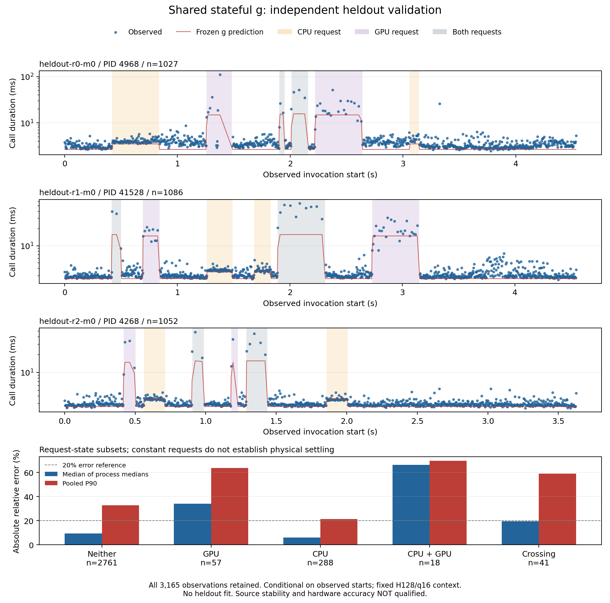

# A shared stateful service-response model

For new physical experiments, use the subsequent
[external available-resource interface](AVAILABLE_RESOURCE_MODEL_20261022.md).
This report preserves the earlier request-pressure hypothesis and its failed
hardware validation; it does not establish externally available CPU/GPU service.

This change makes the state-to-service function `g` explicit in modeling. CPU,
GPU and copy resources use one named-resource framework, followed by the existing
event evaluator. Optional profiling supplies measured parameters and independent
validation; library use does not require a saved profile or a native program.

This is an initial, testable response hypothesis, not an identified GPU scheduler
or a claim that dynamic-device accuracy has passed. A normalized residual-work
state must not be presented as an actual hardware queue.

## One time axis and two responsibilities

For a fixed graph, policy, hardware context and initial state, the execution
result is a functional of external device trajectories. Within execution, each
work demand progresses by its available service integrated over time. Actual
stage boundaries emerge from work completion, dependencies and resource rules.

Modeling now exposes this process through:

```python
service = build_service_response(model, base_parameters, requests,
                                end_ns=..., max_step_ns=..., max_points=...)
result = service.evaluate(graph, start_ns=...)
```

`build_service_response` computes the modeled competition/recovery history and
service timeline. `evaluate` uses the common graph evaluator for progress,
dependencies, resource locks, memory reservations and completion waits. A later
task reads the device state at its actual predicted start time. Independent
resources may overlap; dependencies do not imply serial evaluation of an entire
graph. Memory-capacity violations are explicit, not automatic invented eviction.

## Competition and residual history

For each named background competitor `c`, define a finite normalized state:

```text
dq[c]/dt = arrival[c] * requested[c] - drain[c], clipped to [0, capacity[c]]
```

The request is an externally known workload control, never a utilization
percentage. This finite reservoir is a declared residual-interference proxy.
Excess offered work at saturation is discarded by this approximation; it is not
a lossless queue. The current measurement actor synchronously completes one
replay before checking its next request, and has at most one old replay in flight.
The proxy must not be used to claim a FIFO of many native replay calls.

Pressure has two explicit terms:

```text
pressure[c] = activity_weight[c] * active_fraction[c]
              + backlog_weight[c] * q[c] / capacity[c]
```

While residual work is positive, `active_fraction` is one. When it is empty,
the active fraction is `min(arrival * request / drain, 1)`. This permits active
background work to interfere even when its offered work does not build a queue.
After OFF, residual work continues to drain; an ON reversal retains the current
state rather than resetting its history.

For every target service parameter `j`, CPU, GPU or transfer, the same law is:

```text
g[j](t) = baseline_rate[j](t)
          / (1 + sum(coefficient[j,c] * pressure[c](t)))
```

The full target-by-competitor matrix is explicit, including zero cross terms.
A GPU-background competitor can therefore affect a host target, and CPU
background work can affect a device target. This is a scoped response law;
cross terms alone do not identify which driver, cache or scheduler caused the
effect. Foreground locks remain exclusive in the common engine. This version
does not infer fractional sharing or make background work self-consistently
respond to arbitrary changing foreground schedules.

Physical service coefficients are nonnegative. An explicitly selected signed
domain is supported only for inclusive completed-action responses, with unit
`invocation/s`. Small measured speedups are retained as empirical facilitation
or unresolved context, not negative physical work. The denominator is checked
over the entire allowed pressure box; invalid models are rejected. Negative
estimates are not silently replaced by zero.

## Scope and numerical treatment

All capacities, arrival/drain rates, weights, coefficients, initial residual
states, clocks, origins and evidence are explicit. Missing parameters stay
unknown. Observed diagnostic histories require an explicit replay option and
never establish forecast accuracy. No heldout interruption trace or measured
foreground slowdown may become an ordinary service input.

Reservoir progress uses exact rational arithmetic. Continuously changing
service is represented by a declared left-endpoint approximation. Changing
intervals are bounded by `max_step_ns`; flat intervals jump directly to the
next event. The output records service-rate and integrated-work error bounds.
These are numerical approximation bounds, not physical-model or latency-error
bounds. Forecasts also have a finite supported horizon; unavailable future
service is not extrapolated silently.

The same precomputed history supports many invocation windows. Each window is
sliced at its actual supplied start without resetting residual work. Starting a
new invocation during recovery therefore sees the remaining interference.

The [installed-library example](../examples/library/unified_service_response.py)
declares a CPU/GPU/copy chain and independent background request histories. It
shows nonzero residual pressure after OFF and runs without profiling or hardware.
Its numbers are illustrative and `accuracy_qualified` is false.

## What profiling measures

The optional `profiling/service_response` package keeps the native collection
boundary unchanged. It measures complete foreground action wall intervals,
disjoint host gaps/tail, owned background call intervals and the external GO
request trace, with numerical checks and source/identity receipts.

The predeclared first hardware specialization is intentionally scoped:

* The same fixed H128/q16 F32 mixed CPU/GPU layer is used throughout.
* Each COMPUTE/COPY occurrence has an exact-context baseline completed-action
  price. CPU-only and GPU-only observations estimate separate response
  coefficients. Combined requests do not fit coefficients or proxy parameters.
* Other control/gap/tail intervals use baseline fixed-ns prices. Their state
  independence is an explicit unqualified approximation, not a discovered law.
* Capacity one and activity/backlog weights one are declared structure.
  Isolated profile worker-call medians and OFF-to-completion tails provide
  fill/drain proxies. The normalization mapping is declared; these observations
  do not identify actual GPU queue size or physical CPU/GPU available service.
* Signed coefficients apply to inclusive action progress only. They are not
  pure kernel throughput, CPU active service or PCIe bandwidth. Adding their
  internal GPU/host stages again would double count.

Parameter estimates give independent processes equal weight and retain sample
counts, CV, raw hashes, negative effects, unknowns and failed qualifications.
No DNN, whole-layer fitted offset, total-telemetry predictor or heldout refit is
introduced. Installing the library imports none of these optional estimators.

## Independent validation protocol

Before collection, prepare all six job identities, numeric seeds, trajectories,
source hashes, context, model structure and quality gates. Three profile
processes include short pulses, long isolated/combined requests and off-recovery
windows. Short pulses remain raw observations and do not establish settled
plateau prices. Freeze profile-only parameters before launching three fresh
bare heldout processes, using different orders, dwell times and numeric seeds.

The primary prediction consumes only the exact context, frozen parameters and
predeclared request history. Background call completions are serialized after
STOP and therefore cannot be fed back as heldout prediction inputs. The same
state history persists through all invocations. Combined, crossing, recovery
age, per-process tails and unpredictable observations remain separate report
views. Smaller integration steps are a numerical sensitivity check, not a new
model selected by heldout error.

This experiment predicts invocation duration conditional on an observed external
start time. It is not a freely rolling validation of subsequent launch times or
all multi-round execution. DRAM/VRAM holds are fixed within each process; the
new cohort does not qualify dynamic allocation changes, MoE, SSD or other graphs.

## Remaining integration boundary

The common fine graph supports explicit physical service, completion gates and
same-core interruptions. The first hardware specialization above uses inclusive
completed-action response rates. The general LLM compiler has not automatically
lowered and independently priced every action as fine host/device stages with
the complete tensor-residency ledger. These capabilities share one evaluator;
their timing scopes must not be mixed or claimed interchangeable.

## Independent hardware result

**The framework is implemented; hardware accuracy has not passed.** The first
experiment retains all 3,165 heldout invocations, with 3,165 predictions. The
median of the three process-level median absolute relative errors is **9.43%**,
but pooled P90 is **33.56%** and the worst error is **407.26%**. Most observations
are under neither replay request; the overall median must not stand in for
competition accuracy.

| Fresh process | Calls | Median absolute relative error | P90 error |
|---|---:|---:|---:|
| 4968 | 1,027 | 17.80% | 39.39% |
| 41528 | 1,086 | 9.43% | 31.02% |
| 4268 | 1,052 | 6.83% | 20.84% |

The following subsets preserve the original evaluation's phase-boundary view.
`Neither` includes recovery intervals and does not mean a physically quiescent
machine. Constant requests do not establish physical settling.

| Request during the measured call | Calls | Median of process medians | Pooled P90 |
|---|---:|---:|---:|
| Neither CPU nor GPU replay | 2,761 | 9.55% | 32.84% |
| CPU replay only | 288 | 6.00% | 21.40% |
| GPU replay only | 57 | 34.14% | 63.80% |
| Both replays | 18 | 66.35% | 69.61% |
| Crosses a recorded phase boundary | 41 | 19.50% | 59.19% |



The [vector figure](figures/unified-service-response-20261022.svg) and
[compact evidence export](data/unified-service-response-20261022.json) are
standalone report artifacts. Raw data, all invocation predictions, original
source snapshots and frozen parameters remain in
`profiling/service_response/results/unified-g-v1b-m0-core2/`.

### Why this is not an accuracy pass

* All parameters are numerically available, but **134 of 135 original
  action/state source cells fail the predeclared stability gate**. All 134 fail
  within-process CV; six also fail between-process CV. None fails the minimum
  sample count. Each cell has three independent processes and 96--893 eligible
  action samples per process. More repetition alone does not explain away this
  variability.
* CPU and GPU fill/drain proxies also fail their stability gates. Their point
  estimates are CPU fill 57.9 us / OFF tail 1.0223 ms, and GPU fill 1.5148 ms /
  OFF tail 1.4269 ms. Capacity one, the normalization mapping and pressure
  weights remain declared structure. An OFF-to-last-authorized-call tail does
  not establish hardware quiescence or a physical queue's drain time.
* Ninety coefficients retain 83 positive, six negative and one zero estimate.
  All full-domain denominators remain positive. Negative inclusive effects are
  unresolved empirical context; they are not evidence of negative contention.
* The additive pressure law is an explicit hypothesis. At saturation it implies
  `duration[both] = duration[cpu] + duration[gpu] - duration[neither]` for each
  transformed stage. Combined-load results do not support treating that
  hypothesis as an accepted description of CPU/GPU collaboration and contention.
* Fixed control overhead, profile-versus-heldout instrumentation neutrality,
  arbitrary external applications and transfer to other workloads remain
  unqualified. The exact-context adapter does not calibrate all compiled LLM
  policies automatically.

### A bounded diagnostic of the large errors

Under one unchanged GPU-only request, four adjacent calls in process 4968 take
3.2783, 2.9270, 3.9792 and 3.2428 ms, while the frozen model predicts 14.8474 ms
for each. All four lie inside the same owned GPU worker's **host call** lasting
34.9443 ms; no worker call completes during any of the four. Nearby slow
foreground calls take 16.9531 and 20.8942 ms while overlapping nine and ten
shorter worker calls. Both groups occur well after the declared proxy fill time.
This is evidence that `request ON + saturated reservoir` collapses different
realized closed-loop execution patterns into one state. It is not evidence that
the GPU was idle: a worker host interval includes work and waiting.

Under a constant combined request, process 41528 has a call lasting 55.3750 ms
against a 15.6812 ms prediction. Adjacent calls remain 32.08--55.38 ms under
identical predictions. These errors justify investigating actual host/device
service and feedback between foreground and background execution, rather than
only changing the whole-layer mean. Heldout worker intervals above are used
**only for diagnosis**; no coefficient, state history or prediction was changed.

The [bounded worker-interval diagnostic](data/unified-service-response-worker-diagnostic-20261022.json)
retains raw call indices and source hashes. Worker completions counted inside an
observed foreground wall interval are endogenous: a longer interval can include
more completions. They must not be reused as causal service inputs or presented
as device utilization.

### Numerical sensitivity

A separate offline check keeps the same frozen parameters and halves the
integration step from 250 us to 125 us. All 3,165 primary predictions exactly
match the primary evaluation before comparison. Only 27 half-step predictions
change; the maximum difference is 50.732 us (0.71% of the primary prediction,
or 1.47% of that observation). The median and P90 differences are zero, and the
overall balanced median error remains 9.43%. Each request/service trajectory
uses 80 primary points versus 136 half-step points.

Thus this tested grid change does not remove the long-tail mismatch. It is an
empirical numerical sensitivity check, not a physical-model or latency-error
bound. The [comparison receipt](data/unified-service-response-numerics-20261022.json)
binds the same frozen file, original source inventory and heldout cohort; no
parameter was refitted and no hardware was launched for this comparison.

### Recovery-age audit

The original evaluation records time since the latest **phase** boundary. The
schedule contains adjacent phases with identical requests, including terminal
OFF phases. An additional report view coalesces identical adjacent requests,
without changing any model input, parameter or predicted duration. There are
36 genuine request-crossing calls rather than 41 phase-crossing calls; the five
others have unchanged OFF requests. The original view is retained in full.

For the corrected continuous-OFF view, 2,370 calls follow previous replay load:

| Time continuously OFF at invocation start | Calls | Median of process medians | Pooled P90 |
|---|---:|---:|---:|
| 0--50 ms | 263 | 12.01% | 32.24% |
| 50--150 ms | 398 | 11.37% | 34.71% |
| 150--500 ms | 825 | 8.47% | 34.51% |
| 500--1,000 ms | 451 | 9.96% | 33.42% |
| 1,000--2,000 ms | 433 | 7.44% | 31.48% |

These residuals do not identify a unique recovery time constant. The measured
proxy tails are about a millisecond, while discrepancies persist beyond one
second. This could involve baseline/process context, instrumentation or omitted
longer-lived mechanisms; the current observations do not establish their causal
shares. Treating all such residuals as queued GPU work would be unjustified.

## Reproducibility and verification

The native program is unchanged from the preceding thread-placement diagnostic:
`state-response-native-v1`, executable SHA256
`6344b8e3af7a20f0adabf93df2b32f2ddad4eedcfb76a5043ffcb43fad0f1426`.
The context is one fixed H128/q16/history-0 F32 layer with 117 serial actions,
including 45 COMPUTE/COPY occurrences, CPU threads two, CUDA graphs disabled and
an RTX 4070 Laptop GPU. Foreground process affinity is mask 5 and its owned main
thread is explicitly mask 4. Fixed extra DRAM/VRAM holds are zero; dynamic memory
pressure is not qualified by this cohort.

Three profile processes (5348, 3996, 17304) contribute 14,515 complete invocations
and 1,698,255 retained action intervals. Of these, 195,561 transformed action
intervals enter plateau estimation; they are repetitions inside three processes,
not 195,561 independent experiments. Parameters are frozen before the three
fresh heldout processes (4968, 41528, 4268) start. All six runs pass numerical
checks and owned-process cleanup checks. The experiment archives 474 exact
mutable source files before measurement.

| Artifact | SHA256 |
|---|---|
| Final manifest bytes | `1b11a5da51f50ba3726b6e789d43b89129349a619d206ec79024129eb1bad4d8` |
| Frozen file bytes | `ab01c6325125eb8a658ca644b91469fbe4d14f468bf08f44319012e691009005` |
| Frozen semantic artifact | `4aaf19e0cc8eddd39b5ad65b8aebf174d587add92e3e9a68ea5773bd9a9b9a5f` |
| Primary evaluation bytes | `bc43d8363a1972ce7e4fa60e68739b998f524eaff8e84235e4bdae7557d37ebe` |
| Compact evidence export | `be3144d43a6aa20efb356aeba61b7bae014a3eec4d731b94d32e188b8a10dad0` |

The reusable [profiling instructions](../profiling/service_response/README.md)
cover preparation, collection, source reconstruction, freezing and independent
evaluation. Outputs are write-once. One earlier preparation attempt under
`unified-g-v1-m0-core2` failed because an initial manifest would have been
overwritten; it launched no timed native job and its files are retained. The
corrected preparation uses a new `v1b` directory and numbered checkpoints.

Regression checks completed without failures: modeling 553 tests (seven skips),
public/library/distribution 63 tests, previous state-response tooling 180 tests,
and new profiling tooling 26 tests. The modeling total includes 27 hand-derived
tests for this shared law. The installed-library example runs without a profile,
native program or CUDA requirement. These tests verify software semantics,
not hardware accuracy.

The specialized `evaluate_serial_response` helper currently requires a positive
minimum baseline rate to derive a finite support window. For an explicitly
declared baseline blackout that later recovers, use `evaluate(graph, ...)` with
an explicit horizon. This limitation does not affect the positive-rate hardware
cohort above.

## What the next mechanism experiment should resolve

### Additional error diagnosis after the primary evaluation

These are read-only analyses of existing evidence, not a revised model or new
acceptance cohort. Parameters, predictions and the original evaluation remain
unchanged.

The [bias audit](data/unified-service-response-bias-audit-20261022.json) isolates
the first 419 ms of each fresh process, before any owned replay request turns
ON. The frozen prediction is 2.6570 ms throughout; observed medians are 3.0036,
2.8536 and 2.8818 ms. Of 396 calls, 387 are underpredicted. Consequently, a
recovery-only explanation cannot account for the entire error. This interval
does not establish a physically idle machine or exclude external applications.

A separate [aggregation audit](data/unified-service-response-aggregation-audit-20261022.json)
uses the same stamped profile invocations for both sides of each comparison.
Summing the separate action/gap/tail medians underestimates their actual
complete-call median by 6.7--7.4% with neither replay requested, 6.5--7.5% under
CPU-only requests, 13.7--21.4% under GPU-only requests, and 3.5--5.2% under both
requests. For example, process 5348 has 103 eligible GPU-only calls: their
complete-call median is 18.1276 ms, whereas the sum of their 235 marginal token
medians is 14.2399 ms. Every original token interval telescopes exactly to its
call duration. Thus this discrepancy is aggregation bias, not missing disjoint
time, and it exists without a stamped-versus-bare comparison.

Marginal medians do not preserve which delays occur together within an actual
invocation. High raw CV also does not automatically imply that a median estimate
is wrong or imprecise. The next parameterization must preserve relevant joint
execution context, rather than expecting a sum of marginal medians to be a
representative whole execution.

The frozen saturated predictions for neither, CPU-only, GPU-only and combined
requests are 2.6570, 3.4908, 14.8474 and 15.6812 ms. Even the available stamped
profile combined-call medians are 27.189--32.870 ms. This is a failure visible
before fresh heldout data: independent isolated effects do not predict the
observed joint response under the current pressure mapping. It does not isolate
the causal shares of nonadditive interference, incorrect pressure, driver waits
or foreground/background feedback.

The evidence therefore supports two concrete problems: a lossy construction of
representative action parameters, and a state/response hypothesis that collapses
different realized competition patterns. Instrumentation effects and omitted
long-lived recovery mechanisms remain hypotheses requiring matched controls;
their shares must not be invented from these residuals.

Keep the shared named-resource interface and common graph evaluator. Improve
the **state supplied to g and its mechanism parameters**, rather than creating
separate CPU and GPU total-duration predictors. First distinguish host submission
and active thread service, device completion and blocked waiting under isolated
and combined requests. Test instrumentation neutrality and foreground/background
feedback with matched controlled runs. Then decide whether one residual state is
adequate, or whether explicitly separate runtime/device recovery states and a
measured interaction term are necessary. New mechanisms must live in modeling;
their measurements and source qualifications must live in profiling.

Choose those changes using new profile evidence, freeze again, and collect a
new independent heldout cohort. The current heldout set is now diagnostic
evidence and cannot also serve as untouched acceptance data for the next model.
